<div align="center">
  
</div>

<br/>

<div align="center">

<a href="https://github.com/ishandutta2007/Awesome-Awesome-Awesome"></a>
<a href="https://discord.gg/jc4xtF58Ve"></a>
<a href="https://pypi.org/project/fb-reels-scraper/"></a>
<a href="https://pypi.org/project/fb-reels-scraper/"></a>
<a href="https://opensource.org/licenses/MIT"></a>
<a href="https://github.com/ishandutta2007"></a>

</div>

A robust, two-stage Facebook Reels scraper that operates through your **existing browser session** via a lightweight Chrome/Edge extension and a local Python WebSocket bridge.

By utilizing your real browser session, you completely bypass login hurdles, 2FA prompts, fingerprinting, and bot-detection challenges without needing credentials or headless automation drivers.

---

## ✨ Features

- **No Bot Detection / Captchas**: Works directly inside your logged-in browser tab.
- **Two-Phase Architecture**:
  1. **Phase 1 (Discovery & Harvest)**: Scrolls target profile or page reels feeds (`/reels/`) to collect reel permalinks.
  2. **Phase 2 (Deep Extraction)**: Navigates to individual reel view pages, automatically clicks **"See more"** / **"...more"** to un-truncate descriptions, and extracts the full caption text.
- **Local Smart Caching (`reels_cache.json`)**: Automatically saves extracted reels on the fly. Re-running the script skips previously scraped URLs to save time and bandwidth.
- **Bundled Chrome Extension**: Extension files are packaged directly inside the package and can be exported with a single CLI command (`fb-reels-scraper --install-extension`).
- **Resilient WebSocket Bridge**: Gracefully handles page transitions, DOM reloads, and tab navigation events without throwing disconnect exceptions.

---

## 📦 Installation

### From PyPI
```bash
pip install fb-reels-scraper
```

### Or from source (Editable mode)
```bash
git clone https://github.com/ishandutta2007/fb-reels-scraper.git
cd fb-reels-scraper
pip install -e .
```

---

## 🚀 Quick Setup & Usage

### Step 1: Export & Load the Browser Extension

If installed via `pip`, you can export the bundled extension directory into your current working folder:
```bash
fb-reels-scraper --install-extension
```
*(Or check the internal extension path via `fb-reels-scraper --extension-path`)*

1. Open your Chromium browser (Chrome, Brave, Edge, etc.) and go to `chrome://extensions/` (or `edge://extensions/`).
2. Toggle on **Developer mode** in the top-right corner.
3. Click **Load unpacked** and select the exported `./fb_reels_extension` folder (or `./extension` if running from source).

---

### Step 2: Open Facebook & Run the CLI

1. Ensure you have an active Facebook tab open in your browser where you are logged in.
2. In your terminal, run the CLI tool:

```bash
# Run with default fallback user (nadeemkhancyber) and scroll count (20)
fb-reels-scraper

# Scrape a specific user, page name, or handle
fb-reels-scraper --user zuck

# Short flag with custom scrolls and custom cache file
fb-reels-scraper -u zuck -s 25 -c scraped_data/zuck_reels.json
```

---

## 🛠️ CLI Options Reference

| Flag | Short | Default | Description |
|---|---|---|---|
| `--user` | `-u` | `nadeemkhancyber` | Facebook username, handle, or page name (e.g. `zuck` or `nadeemkhancyber`) |
| `--scrolls` | `-s` | `20` | Number of scroll cycles on the grid to harvest links |
| `--cache-file` | `-c` | `scraped_data/<user>_reels.json` | Path to JSON file where results are cached |
| `--host` | | `127.0.0.1` | WebSocket server bind host |
| `--port` | `-p` | `8765` | WebSocket server bind port |
| `--install-extension` | | `./fb_reels_extension` | Export the bundled extension to a local directory for browser loading |
| `--extension-path` | | — | Print absolute path to the bundled extension directory |
| `--help` | `-h` | — | Display help text and usage instructions |

---

## 🐍 Python Library Usage

You can also import and use `fb-reels-scraper` programmatically in your own Python scripts:

```python
import asyncio
from fb_reels_scraper import scrape_fb_reels, start_server

async def main():
    server = await start_server(host="127.0.0.1", port=8765)
    try:
        results = await scrape_fb_reels(
            target_url="https://www.facebook.com/example/reels/",
            max_scrolls=10,
            cache_file="reels_cache.json"
        )
        print(f"Scraped {len(results)} reels!")
    finally:
        server.close()
        await server.wait_closed()

asyncio.run(main())
```

---

## 📁 Repository Structure

```text
fb-reels-scraper/
├── pyproject.toml               # Modern PEP 517/621 packaging metadata
├── MANIFEST.in                  # Manifest including non-Python extension assets
├── fb_reels_scraper/            # Core Python package
│   ├── __init__.py
│   ├── __main__.py              # python -m fb_reels_scraper support
│   ├── cli.py                   # CLI entrypoint for fb-reels-scraper command
│   ├── scraper.py               # WebSocket bridge & scraping logic
│   └── extension/               # Bundled Chrome Extension (Manifest V3)
│       ├── manifest.json
│       ├── content.js
│       ├── popup.html
│       └── popup.js
├── reels_cache.json             # Cached results
└── README.md
```

---

## 💾 Cache Format

Descriptions are saved to `reels_cache.json` in UTF-8 format:

```json
{
  "https://www.facebook.com/reel/123456789012345/": "Here is the full description and caption of the reel...",
  "https://www.facebook.com/reel/987654321098765/": "[No description found]"
}
```

---

## 🚀 Publishing to PyPI

This repository includes a GitHub Actions workflow ([.github/workflows/publish.yml](.github/workflows/publish.yml)) that automatically builds and publishes the package to PyPI whenever a new version tag is pushed.

### 1. Configure PyPI Authentication (One-time Setup)
You can authenticate via **Trusted Publishing (Recommended by PyPI)** or an **API Token**:

- **Option A: Trusted Publishing (OIDC - Recommended)**:
  1. Go to your project on [PyPI](https://pypi.org/manage/project/fb-reels-scraper/settings/publishing/) (or add a pending publisher before your first release).
  2. Add a new publisher with:
     - Owner: your GitHub username or organization (e.g. `ishandutta2007`)
     - Repository: `fb-reels-scraper`
     - Workflow name: `publish.yml`
     - Environment name: `pypi`

- **Option B: PyPI API Token**:
  1. Generate an API token on [PyPI Account Settings](https://pypi.org/manage/account/token/).
  2. In your GitHub repository, navigate to **Settings** ➔ **Secrets and variables** ➔ **Actions**.
  3. Create a secret named `PYPI_API_TOKEN` and paste your token value.

### 2. Release a New Version
When you are ready to publish an update:

1. Bump the version in `pyproject.toml` and `fb_reels_scraper/__init__.py`:
   ```python
   # pyproject.toml
   version = "1.0.2"

   # fb_reels_scraper/__init__.py
   __version__ = "1.0.2"
   ```
2. Commit the change, tag the release, and push to GitHub:
   ```bash
   git commit -am "Bump version to 1.0.2"
   git tag v1.0.2
   git push origin main --tags
   ```
3. GitHub Actions will automatically trigger, build the wheel and source tarball, and publish them to PyPI.

---

## 💖 Support & Sponsor

Thank you for using and supporting this project! If this tool saved you time or helped in your workflow, please consider:
- ⭐ **Starring** the repository on GitHub
- 🍴 **Forking** and contributing features or improvements
- 📢 **Sharing** it with friends and fellow developers
- ☕ **Buying a coffee / Sponsoring** via the [GitHub Sponsors Dashboard](https://github.com/sponsors/ishandutta2007) to support continuous maintenance and new features.

---

## 📈 Star History

[](https://www.star-history.com/#ishandutta2007/fb-reels-scraper&type=date&legend=top-left)

---

## 🛡️ License

This project is licensed under the [MIT License](LICENSE).
